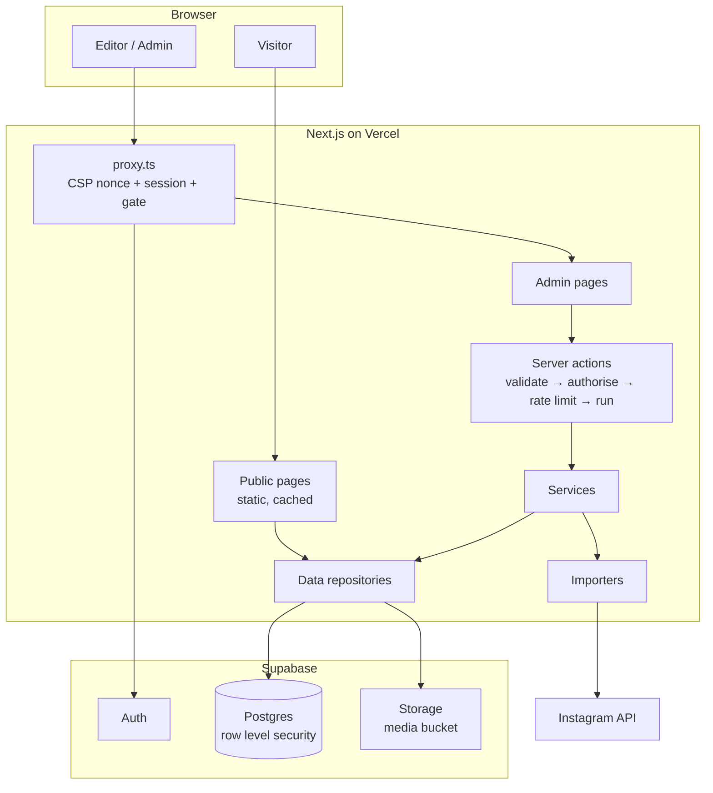

# Tallyfield site

The magazine website for [@tallyfield](https://www.instagram.com/tallyfield/): watch comparisons, reviews and buying guides, with an admin area for importing Instagram posts and writing articles.

**Stack:** Next.js 16 (App Router, TypeScript) · Supabase (Postgres, Auth, Storage) · Vercel · GitHub Actions.

## Status

| Part | State |
|---|---|
| Database schema, access rules, search | Built. 55 SQL checks pass on Postgres 16. |
| Application layers (domain, blocks, data, services, importers, actions) | Built. 33 unit tests pass; lint, type check and production build pass. |
| CI/CD workflows | Running on GitHub (Sagnik220/Tallyfield). Vercel deploys every push to `main`. |
| Public pages | Built from the design: Homepage, Article (`/posts/[slug]`), Archive (search, categories, tags), About. Cached and rebuilt on publish. |
| Admin screens | Posts list (publish / unpublish) and Import from Instagram (fetch, pick cover, edit details, publish). The block editor is next. |
| Sign-in | Email sign-in link (`/login` → `/auth/callback`). New accounts get no role until an admin grants one. |
| Instagram import | Logic built and tested against a simulated API. **Not yet tried against the real Instagram API.** |

## How it fits together



Requests only ever flow downwards through the layers. Each layer has one job:

| Layer | Folder | Job | May import |
|---|---|---|---|
| Config | `src/config` | Environment variables, theme tokens, site constants | nothing |
| Domain | `src/domain` | Types, validation schemas, pure rules | config |
| Blocks | `src/blocks` | The content block types an article is made of | domain |
| Data | `src/data` | Every database and storage query | domain, blocks |
| Integrations | `src/integrations` | Third-party sources (Instagram) and safe downloading | domain |
| Services | `src/services` | Use cases: create a post, publish, import from a link | all of the above |
| Server | `src/server` | Server actions: the only way the browser changes data | services |
| App | `src/app` | Pages, layouts and API routes | everything |

ESLint enforces the "may import" column, so a shortcut across layers fails CI.

## Quick start

```bash
nvm use                       # Node 22
npm install
cp .env.example .env.local    # then fill in the Supabase values
npm run dev                   # http://localhost:3000
```

| Command | What it does |
|---|---|
| `npm run check` | Lint, type check, unit tests and production build. Run before every push. |
| `npm test` | Unit tests |
| `npm run db:test` | Applies every migration to a throwaway Postgres and runs the access-rule tests. Needs `DATABASE_URL`. |
| `npm run db:types` | Regenerates TypeScript types from the linked Supabase project |

## One-time setup

1. **Supabase.** Create a free project. Copy the project URL, publishable key and secret key into `.env.local`.
2. **Database.** `npx supabase link`, then `npx supabase db push --remote --include-seed`.
3. **Lock sign-ups.** In Supabase → Authentication, turn off public sign-ups and invite yourself by email.
4. **First admin.** In the Supabase SQL editor: `update public.profiles set role = 'admin' where id = '<your user id>';` After that, roles are granted from the app with `set_user_role`.
5. **GitHub.** Push this folder to a private repository. Add the secret `SUPABASE_DB_URL`, create an environment called `production` with yourself as required reviewer, and protect `main` (require the CI checks).
6. **Vercel.** Import the repository and add the same environment variables as `.env.local`.
7. **Instagram.** @tallyfield must be a Business or Creator account. Create a Meta developer app, generate a long-lived token, and store it: `insert into public.integration_tokens (provider, access_token, expires_at) values ('instagram', '<token>', '<expiry>');`

## Documentation

| Doc | Read it when |
|---|---|
| [docs/ARCHITECTURE.md](docs/ARCHITECTURE.md) | You want to understand a request from click to database |
| [docs/DATABASE.md](docs/DATABASE.md) | You are changing tables or need the data model |
| [docs/SECURITY.md](docs/SECURITY.md) | You are adding anything that touches auth, secrets or outside input |
| [docs/FUNCTIONS.md](docs/FUNCTIONS.md) | You need to know what a function does and where it lives |
| [docs/EXTENDING.md](docs/EXTENDING.md) | You are adding a block, an importer, a table, a role or a page |
| [docs/CICD.md](docs/CICD.md) | You are setting up or debugging the pipelines |

## Folder map

```
src/
  config/          env.public.ts, env.server.ts, theme.ts, site.ts
  domain/          post.ts, roles.ts, slug.ts, result.ts
  blocks/          registry.ts, types.ts, definitions/<one file per block>
  data/            posts.repo.ts, search.repo.ts, media.repo.ts, sources.repo.ts, tokens.repo.ts
  integrations/    safe-fetch.ts, importers/<source>/
  services/        posts.service.ts, import.service.ts
  server/          action.ts, actions/posts.ts, actions/import.ts
  lib/             action.ts, auth/session.ts, supabase/{server,browser,service}.ts
  app/             pages, layouts, api routes
  proxy.ts         runs before /admin and /login
supabase/
  migrations/      numbered SQL files, applied in order, never edited after merge
  tests/           SQL access-rule tests + a Supabase stand-in for plain Postgres
  seed.sql         categories, tags, default settings
tests/             unit tests
.github/           CI, security scans, database deploy, Dependabot
```
