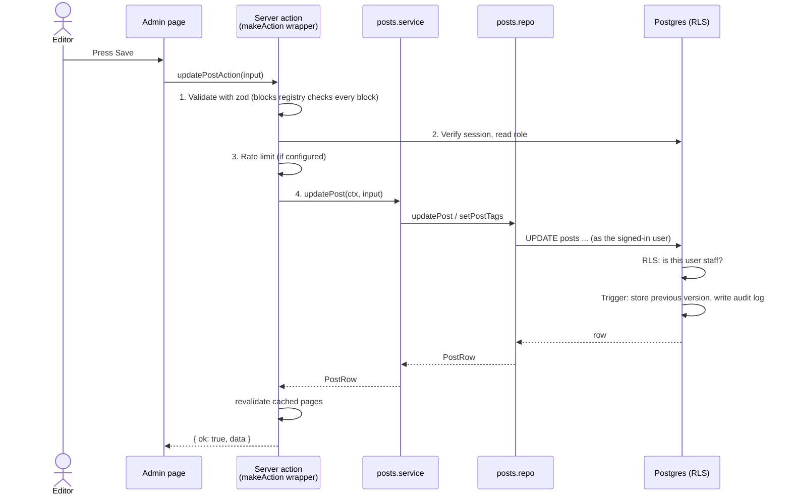
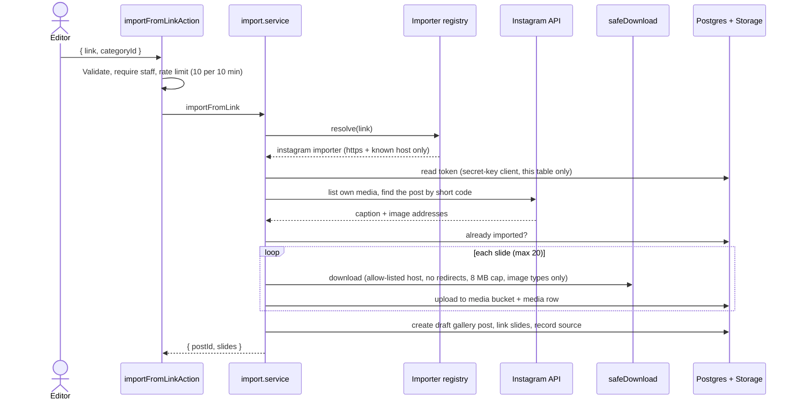
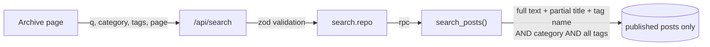
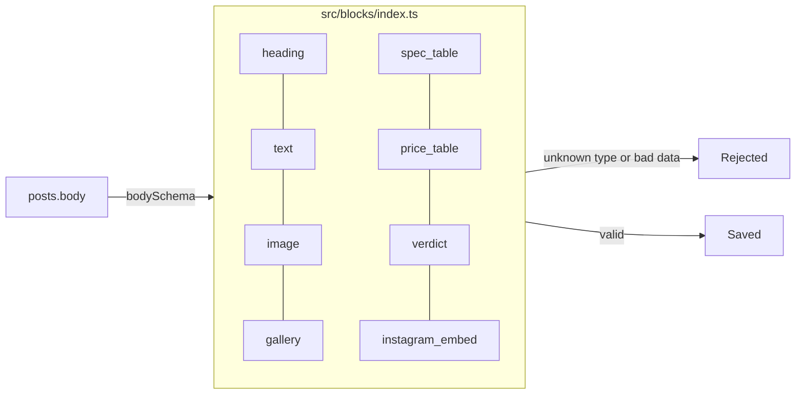

# Architecture

## Principles

1. **The database is the last line of defence.** Every rule about who can read or change what is enforced in Postgres (row level security). The app checks too, but a bug in the app cannot open the data.
2. **One way in.** The browser changes data only through server actions, and every action goes through the same wrapper.
3. **Registries, not switch statements.** Content blocks and import sources are registered in one place each. Adding one does not touch existing code.
4. **Pure core.** `domain` and `blocks` have no database, network or framework code, so they are trivial to test and reuse.
5. **No stored HTML.** Articles are structured data. Nothing a writer or an outside API supplies is ever rendered as markup.

## Saving a post

If any step fails, the action returns `{ ok: false, error: { code, message } }`. Only messages written for people (`AppError`) reach the browser; anything unexpected is logged on the server and replaced with a generic message.

## Importing from an Instagram link

The import always creates a **draft**. Publishing is a separate action, so nothing reaches the public site without a person choosing to publish it.

## Reading (public pages)

Public pages read with the anonymous key. Row level security returns only published posts, so the same query functions are safe to call from any page. Public pages are static or cached; they do not pass through `proxy.ts`.

Search is one database function, `search_posts`, called from `GET /api/search` and from server-rendered pages:

## Content blocks

A post body is `{ "version": 1, "blocks": [ { "id", "type", "data" } ] }`.

Each block definition carries its own validation, its empty state and its plain-text form. House rules live in the block: a price table cannot be saved without a source and a check date, and a verdict cannot be saved without a drawback.

In the UI phase each definition gains a `Renderer` (public page) and an `Editor` (admin) component, registered the same way.

## Where state lives

| State | Lives in | Notes |
|---|---|---|
| Posts, tags, categories, products, prices | Postgres | |
| Images | Supabase Storage, `media` bucket | Random file names; rows in `media` |
| Sign-in session | HTTP-only cookies set by Supabase Auth | Refreshed in `proxy.ts` |
| Roles | `profiles.role` | Changed only by `set_user_role()` |
| Third-party tokens | `integration_tokens` | Server-only |
| Feature flags | `site_settings` | |
| History | `post_revisions`, `audit_log` | Written by triggers; cannot be edited from the app |
