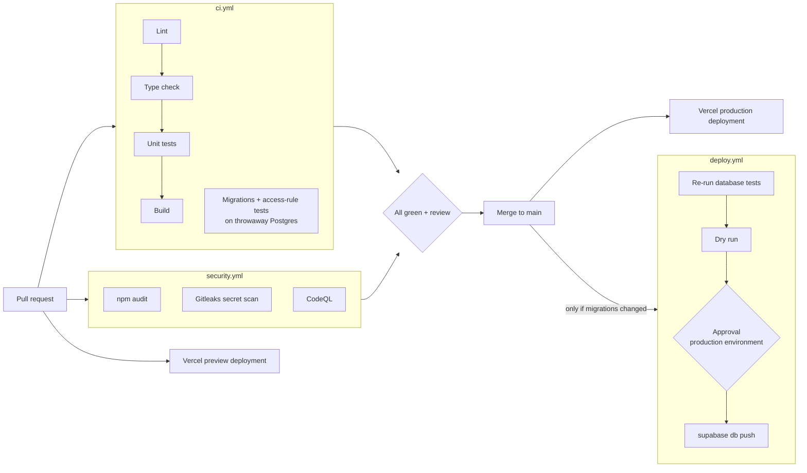

# CI/CD

| Workflow | Runs on | Purpose |
|---|---|---|
| `ci.yml` | every PR and push to `main` | Code quality and database tests. Uses placeholder environment values: no real secrets. |
| `security.yml` | every PR, push to `main`, weekly | Dependency advisories, leaked secrets, static analysis. |
| `deploy.yml` | push to `main` that changes `supabase/migrations/**`, or manual | Applies migrations to production after re-testing and approval. |
| Dependabot | weekly | Opens grouped update PRs for npm packages and GitHub Actions. |

The website itself is deployed by Vercel's Git integration: a preview URL for every pull request, production on merge to `main`.

## One-time GitHub setup

1. **Secret** `SUPABASE_DB_URL`: the project's Postgres connection string (Supabase → Connect). Add it under the `production` environment, not as a repository-wide secret.
2. **Environment** `production`: add yourself as a required reviewer.
3. **Branch protection** on `main`: require a pull request, require the checks "Lint, types, tests, build" and "Migrations and access-rule tests", block force pushes.
4. **Code scanning** and **secret scanning**: turn on under Settings → Security.

## Safety properties

- Workflows have `contents: read` only; CodeQL alone gets `security-events: write`.
- Checkouts do not keep credentials (`persist-credentials: false`).
- Production database credentials exist only in the `production` environment and are used by one job.
- Database deploys never run in parallel, and a running deploy is never cancelled part-way.
- Actions are referenced by major version; Dependabot keeps them current. For stricter supply-chain control, pin each to a commit SHA.

## Rolling back

- **Website:** in Vercel, promote the previous deployment.
- **Database:** migrations are forward-only. Write a new migration that undoes the change, and let it go through the same pipeline.
