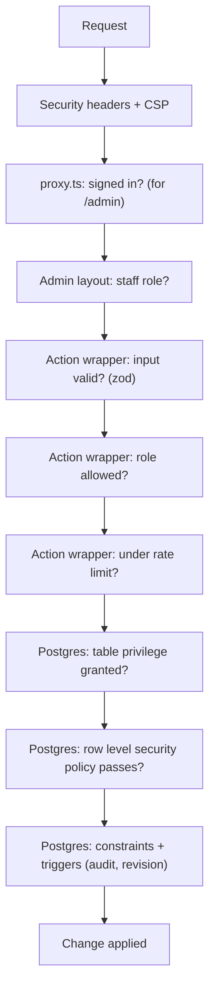

# Security

## Layers

A request to change data must pass every one of these. Each is independent, so a mistake in one is caught by the next.

## Threats and what stops them

| Threat | Defence | Where |
|---|---|---|
| Visitor reads drafts or private data | RLS: only `published` rows are visible; default deny on every table | `…_security.sql`, tested |
| Signed-in user promotes themselves | `profiles.role` is not updatable (column grant); roles change only through `set_user_role()`, which requires admin and refuses self-change | `…_foundations.sql`, tested |
| New sign-up gains access | New profiles get no role; public sign-ups are turned off in Supabase | `handle_new_user()` + setup step 3 |
| Script injection through article content (XSS) | Blocks are structured data with plain-text fields; no HTML is stored or rendered; unknown block types are rejected | `src/blocks` |
| Script injection through an embed | Only an `instagram.com/p/…` address is stored; embed HTML from outside is never saved | `instagram-embed.ts` |
| Inline script injection in the admin | Per-request nonce CSP with `strict-dynamic` on `/admin` and `/login` | `src/proxy.ts` |
| Clickjacking, MIME sniffing, downgrade | `frame-ancestors 'none'`, `X-Frame-Options`, `nosniff`, HSTS | `next.config.ts` |
| Server tricked into fetching internal addresses (SSRF) | https only, allow-listed hosts, no credentials or custom ports, redirects refused, type and size checked, timeout | `src/integrations/safe-fetch.ts`, tested |
| SQL injection | No string-built SQL: the Supabase client and SQL functions use parameters; search escapes `%` and `_` | `search_posts()`, tested |
| Secret key leaks to the browser | Secrets are read only in files marked `server-only`; a browser import fails the build. Only `NEXT_PUBLIC_` values ship | `env.server.ts`, `service.ts` |
| Stolen admin session reads the Instagram token | `integration_tokens` has no grants and no policies; even an admin session cannot read it | tested |
| Abuse of the import (cost, third-party limits) | Per-user rate limit in the database; max 20 slides, 8 MB each | `import.ts`, `hit_rate_limit()` |
| Tampering with history | `audit_log` and `post_revisions` are written by triggers; no role can insert, update or delete them | tested |
| Internal errors leak details | Only `AppError` messages reach the browser; everything else is logged and replaced | `src/lib/action.ts`, tested |
| Cross-site request forgery | Server actions accept only same-origin POSTs (Next.js), session cookies are HTTP-only | framework |
| Vulnerable dependency | `npm audit` on every PR and weekly; Dependabot updates | `security.yml`, `dependabot.yml` |
| Secret committed by mistake | Gitleaks scans every PR and the full history; `.env*` is git-ignored | `security.yml`, `.gitignore` |
| Bad migration reaches production | Migrations are tested in CI, re-tested before deploy, shown as a dry run, and need approval | `deploy.yml` |

## Rules when adding code

- A new **server action** must be created with `action({ roles, schema, ... })`. Never export a bare async function that touches the database.
- A new **table** needs RLS, grants, policies and tests (see [DATABASE.md](DATABASE.md)).
- **Never** use `createServiceClient()` outside `src/data/tokens.repo.ts` without writing down why in this file. It bypasses every database rule.
- **Never** render stored text as HTML (`dangerouslySetInnerHTML`).
- Any **server-side fetch of an address that came from outside** goes through `safeDownload` / `assertSafeUrl`.
- New **environment variables**: add to `.env.example` and to `env.public.ts` or `env.server.ts`. Only values that are safe in the browser get the `NEXT_PUBLIC_` prefix.

## Known gaps (to close before launch)

| Gap | Why it matters | Plan |
|---|---|---|
| Public pages use a CSP with `'unsafe-inline'` for scripts | Static pages cannot carry a per-request nonce | Acceptable while public pages render no user-typed HTML; revisit with hash-based CSP |
| Instagram token is stored as plain text in a locked table | A database backup would contain it | Move to Supabase Vault |
| No automatic token refresh | Long-lived Instagram tokens expire | Scheduled refresh job |
| No two-factor sign-in | Admin accounts rely on email sign-in alone | Turn on MFA in Supabase Auth when the sign-in form is built |
| Draft images are in a public bucket | Anyone with the exact random URL could fetch one | Acceptable (unguessable names); switch to signed URLs if drafts become sensitive |
| Access rules are tested on plain Postgres with a Supabase stand-in | Real Supabase could differ in defaults | Run the same checks once against a Supabase branch before launch |
